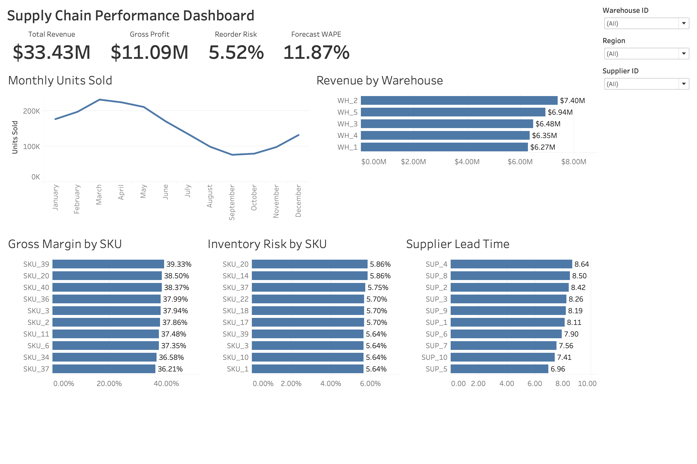

# Supply Chain Analytics

An end-to-end supply chain analytics project analyzing 91,250 operational records across inventory, sales, forecasting, warehouses, and suppliers.

I used **Python and Pandas** to clean and transform the data, **SQL/SQLite** for analysis, and **Tableau** to build an interactive performance dashboard.

## Dashboard



The dashboard includes filters for warehouse, region, and supplier.

### Key KPIs

- **Estimated Revenue:** $33.43M
- **Estimated Gross Profit:** $11.09M
- **Reorder Risk:** 5.52%
- **Forecast WAPE:** 11.87%

## Tools & Skills

- **Python / Pandas** — data cleaning, validation, feature engineering, and automation
- **SQL / SQLite** — aggregations, CTEs, window functions, and KPI analysis
- **Tableau** — dashboard development, calculated fields, filters, and data visualization
- **Jupyter Notebook** — exploratory data analysis

## Key Findings

- WH_2 generated the highest estimated warehouse revenue at **$7.40M**, despite unit sales being similar across warehouses.
- Monthly demand peaked around March, declined through September, and began recovering toward year-end.
- Forecast MAE remained near **2.3–2.4 units**, while WAPE increased during lower-demand months, resulting in an overall WAPE of **11.87%**.
- Reorder risk was relatively consistent across SKUs; the highest observed rate was approximately **5.86%**.
- Average supplier lead times ranged from **6.96 to 8.64 days**, with no clear relationship between longer lead times and reorder risk.

## Project Workflow

```text
Raw Data → Python/Pandas → Cleaned Data → SQLite/SQL → Tableau Dashboard
```

## Project Structure

```text
├── data/
├── images/
├── notebooks/
├── scripts/
│   ├── clean_data.py
│   └── load_database.py
├── sql/
│   └── analysis_queries.sql
├── tableau/
├── requirements.txt
└── README.md
```

## Notes

Revenue and gross profit are estimated from unit sales, unit price, and unit cost.

Because the dataset's `Stockout_Flag` contains only zero values, reorder risk was calculated using **Inventory Level ≤ Reorder Point** rather than presenting an actual stockout rate.